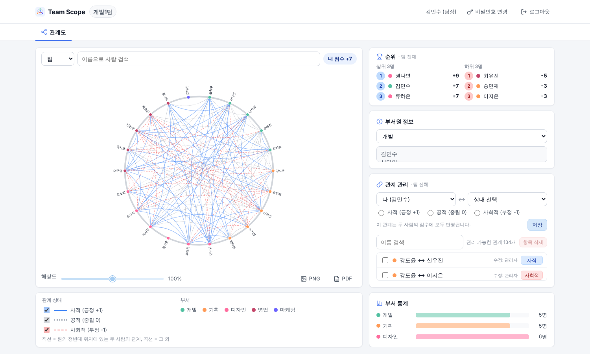
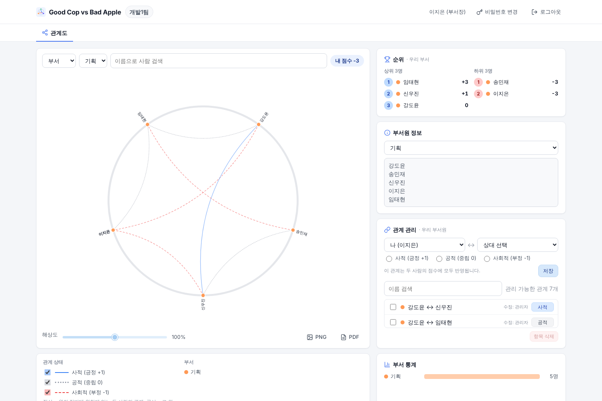
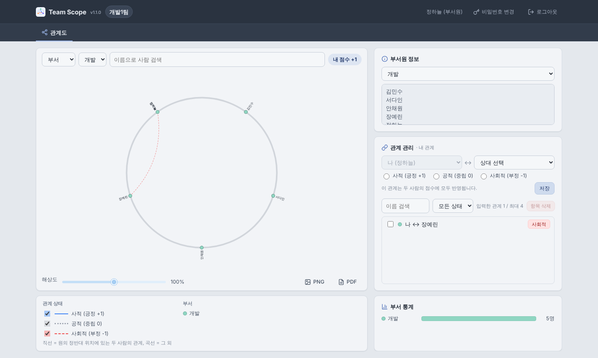
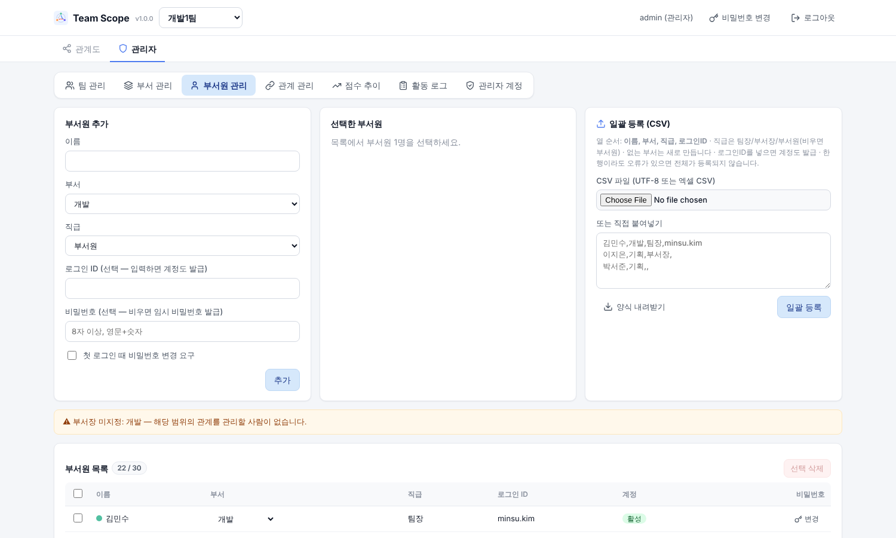
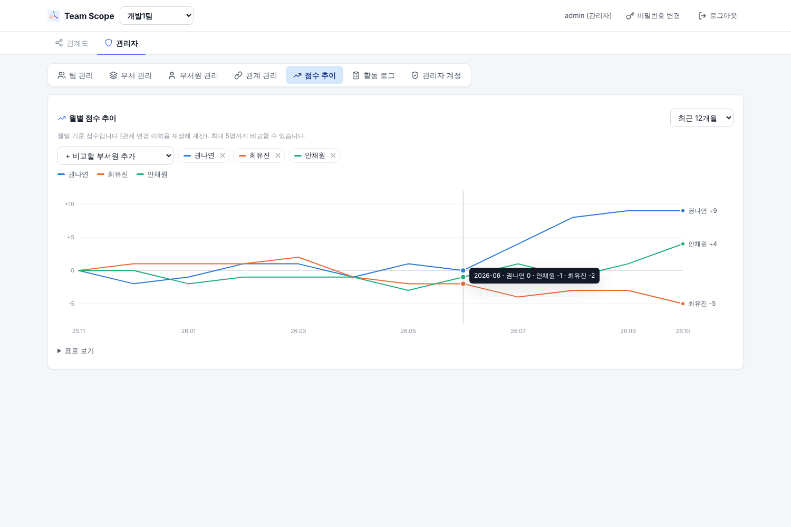
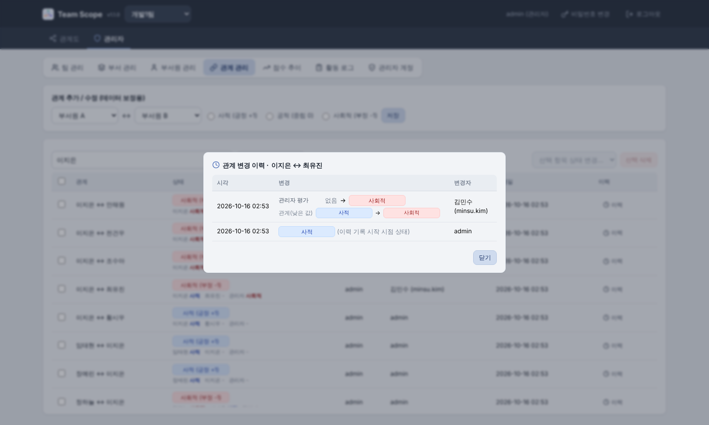

<div align="center">


# Team Scope

**팀 내 인간관계를 원형 관계도로 시각화하는 다중 사용자 웹 애플리케이션**

[](https://github.com/resious71/Team_N_Scope/releases/tag/v1.2.2)
[](LICENSE)
[](https://www.php.net/)
[](https://d3js.org/)
[](#데이터와-보안)

[주요 기능](#주요-기능) · [빠른 시작](#빠른-시작) · [배포](#배포) · [문서](#문서) · [기여](#기여) · [변경 이력](CHANGELOG.md)


</div>

## 소개

Team Scope는 팀원들이 서로의 관계를 **사적(긍정 +1) · 공적(중립 0) · 사회적(부정 −1)** 으로 입력하고, 그 결과를 D3.js 원형 관계도와 점수·순위로 보여 주는 웹 앱입니다.

- 관리자가 팀·부서·부서원·계정을 관리합니다.
- 부서원은 로그인해 자신의 관계를 직접 입력합니다.
- 팀장은 팀 전체, 부서장은 자기 부서의 관계도와 모든 관계를 보고, 본인 관계를 입력합니다.

별도 DB 없이 **PHP + JSON 파일**만으로 동작해 일반 웹 호스팅에도 쉽게 올릴 수 있습니다.

> ⚠️ 관계 평가는 민감한 개인정보입니다. 운영 전에 조직의 개인정보·인사 규정을 검토하고, [보안 체크리스트](SECURITY.md#운영자를-위한-보안-체크리스트)를 확인하세요.

## 주요 기능

### 관계도
- **원형 관계도**
  - 노드를 균등 간격으로 배치하고, 정반대에 있는 두 사람의 관계만 직선, 나머지는 곡선으로 그립니다.
  - 상태별로 색과 선 스타일(실선·점선·파선)을 다르게 하고, 상태별로 켜고 끌 수 있습니다.
- **범위 필터**: 팀 / 부서 / 부서원 단위로 볼 수 있고, 사람 검색 강조와 해상도 슬라이더가 있습니다.
- **부서원 화면 이름 가림**: 부서원의 관계도에는 다른 사람 이름의 마지막 한 글자만 표시합니다.
- **PNG·PDF 저장**: 제목·범위·날짜·범례를 포함해 내려받습니다.
- **30초 자동 갱신**: 다른 사용자의 변경이 화면에 반영됩니다.

### 역할과 직급

| | 볼 수 있는 관계 | 입력할 수 있는 평가 | 점수·순위 |
|---|---|---|---|
| **관리자** | **모든 관계** (낮은 값, 쌍마다 각자의 평가까지) | 팀 전체 (관리자 평가) | 팀 전체 |
| **팀장** | 팀 전체 (모든 부서, 낮은 값) | 팀 전체 인원에 대한 본인 평가 | 팀 전체 |
| **부서장** | 자기 부서원 사이 모든 관계 (낮은 값) | 같은 부서원에 대한 본인 평가 | 자기 부서 |
| **부서원** | 본인이 등록한 평가만 | 같은 부서원에 대한 본인 평가 | 본인 점수만 |

- 팀장은 팀당 1명, 부서장은 부서당 1명입니다.
- 모든 권한은 **서버에서** 검사하고, 보이면 안 되는 데이터는 처음부터 내려보내지 않습니다.
- **관계 평가는 입력한 사람별로 따로 저장**됩니다: A의 평가, B의 평가, 관리자 평가(관리자가 입력).
  - 부서원은 본인이 등록한 평가만 보며, 다른 사람이 입력한 평가는 본인이 포함돼도 보이지 않습니다.
  - 팀장·부서장은 범위 안의 다른 사람들 관계를 **보기만** 하고, 추가·수정·삭제는 본인이 당사자인 관계만 합니다. 쌍마다 누가 어떤 평가를 했는지는 관리자만 봅니다.
  - 점수는 쌍의 평가 중 **점수가 낮은 값**으로 계산합니다 (관리자 관계도도 낮은 값).
  - 당사자가 삭제하면 본인 평가만, 관리자가 삭제하면 쌍의 평가 전체가 지워집니다.

### 관리자 기능
- 팀(인원 한도·공개 범위), 부서(색상), 부서원(직급·계정) 관리, 팀 JSON 내보내기·가져오기
- 부서원 추가 시 비밀번호 직접 지정, 부서원 목록에서 바로 부서 변경·비밀번호 변경 (모든 사용자는 헤더에서 본인 비밀번호 변경 가능)
- **CSV 일괄 등록**
  - 엑셀 CSV도 읽고, 없는 부서는 자동으로 만들며, 계정과 임시 비밀번호도 함께 발급합니다.
  - 한 행이라도 오류가 있으면 아무것도 등록하지 않습니다.
- 관계 관리 이름·상태 필터, **관계 변경 이력**과 **월별 점수 추이** 차트
- **활동 로그** 검색(기간·분류·사용자·검색어)과 페이지 넘김
- **관리자 계정** 관리: 추가, 비밀번호 초기화, 잠금 해제, 활성/비활성
- 팀장·부서장이 비었을 때 경고

### 보안
- 세션 로그인, CSRF 토큰, 매 요청마다 계정 상태 재확인(비활성화하면 기존 세션도 즉시 차단)
- `로그인 ID + IP` 기준 로그인 잠금, 임시 비밀번호 변경 강제, 개인정보 안내 동의(안내문 개정 시 재동의)
- 보안 헤더와 CSP(`script-src 'self'`), 외부 CDN 없이 D3를 저장소에 포함

## 스크린샷

| 팀장 화면 | 부서장 화면 (자기 부서만) | 부서원 화면 |
|---|---|---|
|  |  |  |

| 부서원 관리 · CSV 일괄 등록 | 월별 점수 추이 | 관계 변경 이력 |
|---|---|---|
|  |  |  |

## 빠른 시작

**필요한 것**: PHP 8.1 이상. Node.js, DB, 빌드 도구는 필요 없습니다.

```bash
git clone https://github.com/resious71/Team_N_Scope.git
cd Team_N_Scope
php -S localhost:8000 router.php
```

1. 브라우저에서 <http://localhost:8000>을 엽니다.
2. 기본 관리자 **`admin` / `admin`** 으로 로그인하고 개인정보 안내에 동의합니다.
3. **관리자 → 팀 관리**에서 "샘플 데이터 생성"을 체크하고 팀을 추가하면 20명짜리 예시 팀이 만들어집니다.

> 기본 관리자는 관리자 계정이 하나도 없을 때 자동으로 만들어집니다. 누구나 추측할 수 있는 비밀번호이므로 **운영 서버에서는 즉시 바꾸세요.**

## 배포

두 가지 방식을 지원합니다. 자세한 설정(nginx·Apache·PHP 예시, 백업·복구)은 [운영 문서](docs/OPERATIONS.md)를 참고하세요.

| 방식 | 방법 | 비고 |
|---|---|---|
| **프로젝트 폴더** (간편) | `htdocs/Team_N_Scope/`에 두고 `https://서버/Team_N_Scope/`로 접속 | Apache `AllowOverride All` 필요. 배포 후 `…/data/users.json`이 404/403인지 확인 |
| **`public/` document root** (권장) | 웹 서버의 document root를 `public/`으로 지정 | `data/`가 웹에 전혀 노출되지 않음 |

운영 환경에서는 **HTTPS가 필수**입니다. 백업은 cron으로 매일 실행합니다.

```cron
30 3 * * * cd /srv/team-scope && php tools/backup.php /var/backups/team-scope
```

## 설정

설정값은 `public/api/storage.php` 맨 위의 상수에 있습니다.

| 상수 | 기본값 | 설명 |
|---|---|---|
| `DEFAULT_MAX_MEMBERS` / `SYSTEM_MAX_MEMBERS` | 30 / 100 | 팀 인원 한도 기본값 / 상한 |
| `SESSION_IDLE_SECONDS` | 7200 | 세션 유휴 만료 (120분) |
| `LOGIN_FAIL_LIMIT` / `LOGIN_LOCK_SECONDS` | 5 / 600 | 로그인 실패 허용 횟수 / 잠금 시간 |
| `AUDIT_RETENTION_MONTHS` / `BACKUP_KEEP_DAYS` | 12 / 14 | 활동 로그 / 백업 보관 기간 |
| `PRIVACY_NOTICE`, `PRIVACY_NOTICE_VERSION` | — | 개인정보 안내문과 개정일 (올리면 전원 재동의) |
| `DEFAULT_ADMIN_LOGIN` / `DEFAULT_ADMIN_PASSWORD` | admin / admin | 자동 생성되는 기본 관리자 |

환경 변수:
- `GCBA_DATA_DIR`: 데이터 폴더 위치 (기본값은 저장소의 `data/`)
- `GCBA_TRUST_PROXY=1`: 신뢰하는 리버스 프록시 뒤에서 실제 IP와 HTTPS를 인식

## 데이터와 보안

- 모든 데이터는 `data/` 아래 JSON 파일에 저장됩니다. git에는 포함되지 않습니다.
  - `users.json`, `user_state.json`, `teams.json`, `teams/{id}.json`
  - `history/{id}.jsonl` (관계 변경 이력), `audit/YYYY-MM.log` (활동 로그), `trash/` (삭제된 팀)
- 쓰기는 `data/.lock`에 `flock`을 건 상태에서 임시 파일에 쓰고 `rename()`으로 교체합니다. API는 변경된 것만 보내는 방식이라 동시에 사용해도 서로의 변경을 덮어쓰지 않습니다.
- 점수는 저장하지 않고 관계에서 매번 계산합니다.
- 관리자 CLI: `php tools/admin_cli.php create-admin|reset-password|unlock|list-admins`
- 이전 버전 데이터 마이그레이션: `php tools/migrate.php --dry-run` 으로 확인 후 `php tools/migrate.php` (예전 서버 데이터는 `--from <data 폴더|백업.tar.gz>`). 자세한 내용은 [운영 문서](docs/OPERATIONS.md#5-업그레이드--마이그레이션)

## 테스트

```bash
php tests/api_test.php
php tests/migrate_test.php   # 이전 버전 데이터 마이그레이션
```

임시 데이터 폴더로 내장 서버를 띄워 **126개 항목**(API)과 **26개 항목**(마이그레이션)을 검사합니다. 인증·CSRF, 역할·직급별 권한, 데이터 노출 범위, 점수 규칙, 인원 한도, 가져오기 검증, 이력·추이, 일괄 등록, 동시 쓰기, 백업·복구가 포함됩니다.

## 프로젝트 구조

```
index.php              프로젝트 폴더 진입점
.htaccess / router.php 웹 접근 차단 규칙 (Apache / PHP 내장 서버)
public/
  index.html, app.js, style.css, favicon.svg
  lib/d3.v7.min.js     D3 v7.9.0 (로컬 배치)
  api/index.php        API 진입점 (action 분기·권한 검사)
  api/auth.php         세션·로그인·CSRF·비밀번호·로그인 잠금
  api/storage.php      저장소·잠금·권한 규칙·점수·이력·로그·설정 상수
tools/                 admin_cli.php, backup.php, migrate.php
tests/                 api_test.php (API 통합), migrate_test.php (마이그레이션)
docs/                  OPERATIONS.md, screenshots/
```

## 문서

- [운영 문서](docs/OPERATIONS.md): 웹 서버·PHP 설정, 관리자 계정, 백업·복구, 장애 대응
- [보안 정책](SECURITY.md): 취약점 제보, 운영 보안 체크리스트
- [변경 이력](CHANGELOG.md)

## 기여

버그 제보, 기능 제안, PR 모두 환영합니다. 시작하기 전에 [기여 안내](CONTRIBUTING.md)와 [행동 강령](CODE_OF_CONDUCT.md)을 읽어 주세요. 보안 문제는 공개 이슈 대신 [비공개 제보](SECURITY.md)를 이용해 주세요.

## 라이선스

[MIT](LICENSE) © 2026 resious71 and Team Scope contributors

포함된 서드파티: [D3.js](https://d3js.org/) v7.9.0 — ISC License ([`public/lib/d3.LICENSE.txt`](public/lib/d3.LICENSE.txt))
