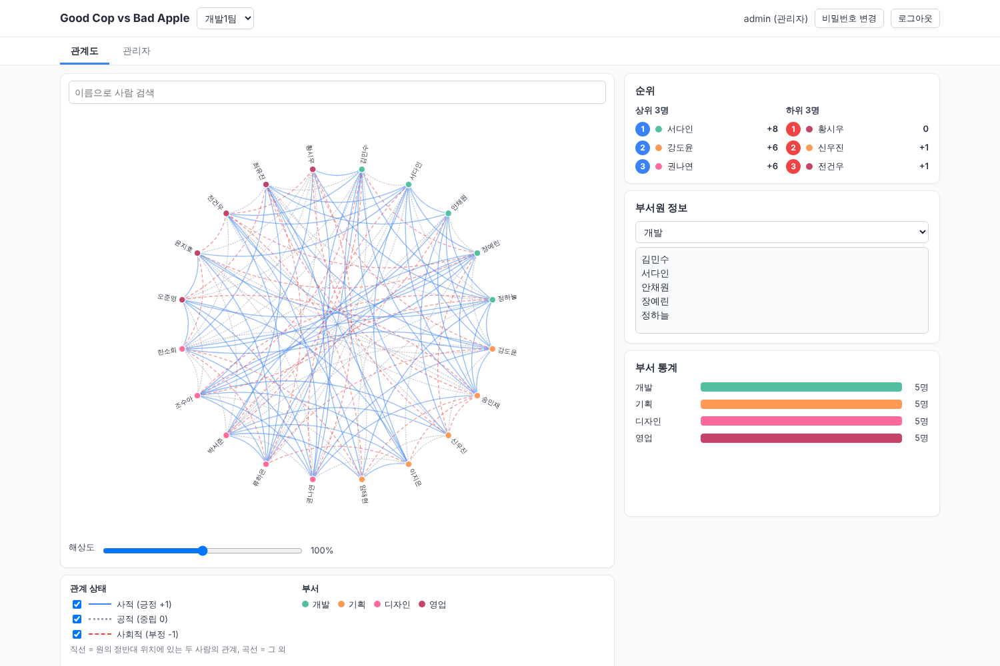

# Good Cop vs Bad Apple (v4)

팀 내 인간관계를 시각화하는 다중 사용자 웹 애플리케이션입니다. 관리자는 팀·부서·부서원·계정을 관리하고, 부서원은 로그인해 자신의 관계를 직접 입력합니다.

- 기술: HTML / CSS / JavaScript(ES6+, D3.js v7 로컬) / PHP 8.1+ / JSON 파일 저장
- 브라우저 저장소(localStorage 등)는 사용하지 않으며, 모든 데이터는 `data/`의 JSON 파일에 PHP API로만 읽고 씁니다.



## 폴더 구조

```
public/              웹 루트 (document root)
  index.html, style.css, app.js
  lib/d3.v7.min.js   D3 v7.9.0 (CSP 적용을 위해 로컬 배치)
  api/index.php      API 진입점 (action 분기·권한 검사)
  api/auth.php       세션·로그인·CSRF·비밀번호·로그인 실패 제한
  api/storage.php    JSON 저장소·잠금·검증·점수 계산·활동 로그·설정 상수
tools/
  admin_cli.php      관리자 계정 생성·비밀번호 초기화·잠금 해제 (CLI 전용)
  backup.php         data/ 백업 (cron)
tests/api_test.php   API 통합 테스트 (수용 기준 검사)
docs/OPERATIONS.md   운영 문서 (웹 서버 설정, 백업·복구, 보안)
data/                런타임 데이터 (웹 루트 밖, git 제외, 최초 요청 시 자동 생성)
```

## 빠르게 실행하기 (개발)

```bash
php tools/admin_cli.php create-admin admin          # 비밀번호 입력 (또는 --generate로 임시 비밀번호)
php -S localhost:8000 -t public
# http://localhost:8000 접속 → admin 로그인 → 개인정보 동의 → 관리자 탭 > 팀 관리에서 "샘플 데이터 생성"으로 팀 추가
```

데이터 폴더 위치는 환경 변수 `GCBA_DATA_DIR`로 바꿀 수 있습니다 (기본값: 저장소 루트의 `data/`).

## 테스트

```bash
php tests/api_test.php
```

임시 data 폴더로 내장 서버를 띄워 12장의 수용 기준을 검사합니다: CLI 관리자 생성, 임시 비밀번호·미동의 차단, CSRF, 역할별 403, 타 팀 접근 차단, 로그인 ID+IP 잠금, 비활성화 계정의 기존 세션 401, 관계 upsert·양 당사자 수정, `own`/`team` 공개 범위 필터링, 2.6 점수 규칙, 인원 한도, 가져오기 검증(참조 무결성·중복 쌍·전부 성공 또는 전부 실패), 팀 삭제→trash→복구, 병렬 쓰기 시 JSON 무결성, 백업·복구.

## 주요 설계 메모

- **관계**: 무방향. ID는 두 부서원 ID를 정렬해 `{a}_{b}`. 부서원 요청에는 상대 ID와 상태만 보내며 본인은 서버가 세션에서 결정합니다.
- **점수**: 저장하지 않고 매번 계산합니다 (본인이 포함된 관계 값의 합, 사적 +1 / 공적 0 / 사회적 −1).
- **부서원에게 보내는 데이터**: 타인 점수, 순위, 입력자·수정자 정보는 서버에서 제외하고, `own` 범위에서는 본인 관계만 내려보냅니다.
- **쓰기**: `data/.lock`에 `flock` → 읽기·수정 → 임시 파일 쓰기 → `rename()`. 변경 단위 API만 있고 전체 덮어쓰기 API는 없습니다.
- **관계도**: `d3.cluster()`의 `separation`을 항상 1로 지정해 노드를 균등 배치합니다. 각도 차이가 180°±0.5°인 쌍만 직선으로 그리고, 나머지는 현의 중점에서 중심 방향으로 (현 길이 × 0.25)만큼 이동한 점을 제어점으로 하는 2차 베지어 곡선으로 그립니다. 엣지마다 투명한 10px 히트 영역이 있습니다.
- **해상도 슬라이더**: 100%는 차트 영역(최대 800px)에 딱 맞는 크기이고, 100%를 넘으면 스크롤됩니다.
- **설정 상수**(기본 인원 한도 30, 시스템 상한 100, 세션 120분, 잠금 정책, 개인정보 안내문과 개정일 등)는 `public/api/storage.php` 상단에 있습니다. 안내문을 고치면 `PRIVACY_NOTICE_VERSION`을 올려 재동의를 받습니다.

운영 배포는 [docs/OPERATIONS.md](docs/OPERATIONS.md)를 참고하세요.
